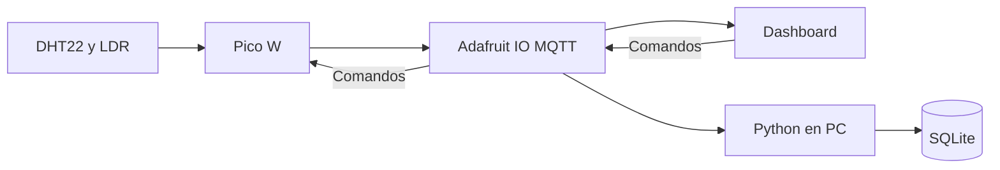

# Monitoreo industrial — Grupo 4

Integrantes: Manuel Borbua, Brian Cona y Carlos Cumbrera.

## Funcionamiento

Se monitorean temperatura, humedad y luz de una estación de producción de bebidas. Si la temperatura supera 30 °C, la humedad supera 70 % o la lectura de luz es inferior a 15000, se enciende el LED rojo. En condiciones normales se enciende el verde.

## Circuito

- DHT22: GP16
- LDR: GP26 (ADC)
- LED verde: GP18, resistencia de 220 ohmios
- LED rojo: GP19, resistencia de 220 ohmios

El archivo `diagram.json` conserva el circuito del proyecto básico.

## Configuración de Adafruit IO

1. Crear una cuenta en https://io.adafruit.com/.
2. Crear estos feeds exactamente: `temperatura`, `humedad`, `luz`, `estado`, `comando`, `eventos`.
3. Copiar el usuario y la clave AIO Key en `config.py` (no publicar la clave en GitHub).
4. Crear un dashboard con tres indicadores o gráficas para los sensores, un bloque de texto para `estado` y un bloque de control de texto para el feed `comando`.
5. Enviar desde el dashboard uno de estos comandos: `auto`, `alerta`, `normal`.

`auto` aplica los límites de sensores; `alerta` fuerza el LED rojo; `normal` fuerza el LED verde. Los dos últimos son modos de demostración y no deben utilizarse como controles de seguridad industrial real.

## Wokwi

Subir `main.py`, `config.py`, `umqtt/simple.py` y `diagram.json` a un proyecto Raspberry Pi Pico W con MicroPython. `umqtt/simple.py` debe ser la biblioteca estándar `umqtt.simple` de MicroPython; el proyecto no la incluye para evitar distribuir una versión no verificada. Si Wokwi tiene la biblioteca preinstalada, no hace falta subirla. No utilizar `pip install paho-mqtt` dentro de MicroPython.

Wokwi-GUEST debe tener salida funcional a Internet para conectar a `io.adafruit.com` por MQTT. Si aparece `STALL`, errores DNS o conexión TCP, la simulación de GPIO puede funcionar pero la integración cloud no está demostrada. En ese caso probar en una Pico W física o en un entorno Wokwi con red habilitada.

## Base de datos en computadora

Instalar Python y ejecutar:

```bash
pip install -r requirements.txt
python guardar_datos.py
```

El programa escucha los feeds MQTT y crea `industrial.db`. Las lecturas se guardan al recibir `estado` (enviado después de los tres sensores), y los comandos/eventos en la tabla `eventos`. Mantener el programa abierto mientras se prueba. Los datos de SQLite tienen fecha/hora de recepción en la computadora.

Para consultar el historial con SQLite:

```sql
SELECT * FROM lecturas ORDER BY id DESC LIMIT 20;
SELECT * FROM eventos ORDER BY id DESC LIMIT 20;
```

## Arquitectura



## Flujo

1. La Pico W lee ambos sensores.
2. Enciende el LED correspondiente y publica temperatura, humedad, luz y estado.
3. Adafruit IO recibe los valores y los presenta en el dashboard.
4. El programa de la computadora recibe los feeds y guarda históricos en SQLite.
5. Un comando desde el dashboard llega por MQTT a la Pico W y cambia el modo.

## Reparto sugerido para sustentar

- Estudiante 1: sensores, GPIO y condiciones de alerta.
- Estudiante 2: conexión WiFi, MQTT y dashboard.
- Estudiante 3: base de datos, consultas e integración.

## Verificación pendiente

Se debe probar la conexión real de Wokwi a Adafruit IO, la recepción de comandos y la creación de registros en SQLite. La entrega de archivos no demuestra por sí sola la integración. Agregar capturas del circuito, dashboard, consola, consultas SQL y enlace del repositorio.
